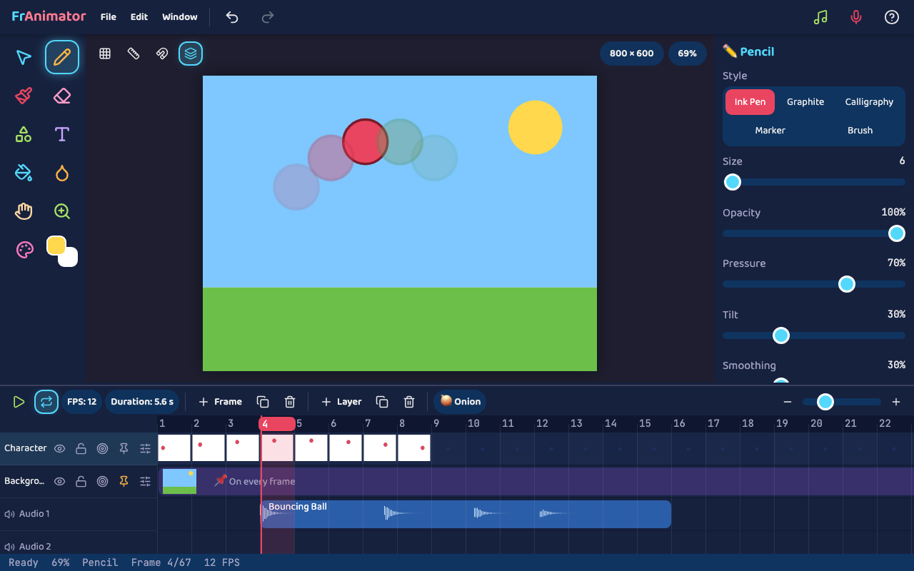

# FrAnimator

A web-based 2D raster drawing and frame-by-frame animation tool for children. It runs in any modern browser on desktop and iPad, works offline, and keeps everything on the device.



## Quick start

```bash
npm install
```

```bash
npm run dev
```

Then open the URL Vite prints (usually http://localhost:5173).

| Command | What it does |
| --- | --- |
| `npm run dev` | Development server with hot reload |
| `npm run build` | Typecheck, then build to `dist/` |
| `npm run preview` | Serve the production build |
| `npm test` | Unit tests (Vitest) |
| `npm run test:e2e` | Browser tests in Chromium and WebKit (Playwright) |
| `npm run typecheck` / `npm run lint` | Strict TypeScript check. No separate linter: `typescript-eslint` did not install alongside TypeScript 7 |

First-time setup for browser tests:

```bash
npx playwright install chromium webkit
```

The app needs no environment variables, so there is no `.env` file. `dist/` is a static site and can be hosted anywhere. Microphone recording and the service worker require HTTPS outside localhost.

## Publishing on GitHub Pages

The site is at **https://nate77-a.github.io/FrAnimator/** once deployed. Every push to `main` runs [the workflow](.github/workflows/deploy.yml): typecheck, unit tests and build must pass before it publishes. Browser tests run alongside it and are reported, but don't block publishing.

One-time setup: in the repository on GitHub, open **Settings → Pages** and set **Source** to **GitHub Actions**. On a free GitHub plan the repository must be public for Pages to work.

Asset paths are relative, so the site keeps working if the repository is renamed or moved to a custom domain.

## Design documents

The design lives in `docs/`, with every review change kept as a tracked change:

- `Animation Tool Specification.docx`: what the product is. **§2.1 Core Architecture Rules** is the best starting point.
- `STAGED BUILD PROCESS FOR CLAUDE.docx`: how it was built, stage by stage.

## Architecture

Project state is plain immutable data. Konva is only a view of it.

```
 pointer input (tools/input.ts, outside React)
        │
        ▼
 Stroke buffer ──► BitmapStore (pixels, LRU to PNG)
        │                 ▲
        ▼                 │
 Zustand + Immer ──► ProjectDoc (undo = pointer swap + pixel patches)
        │
        ├──► Scene (live Konva stage)
        └──► Compositor ──► thumbnails, onion skin, PNG / GIF / MP4
                 ▲
       render/nodes.ts: one factory for every Konva node
```

| Folder | Holds |
| --- | --- |
| `src/core` | Document types and helpers, store, history, bitmaps, `.franimator` files, auto-save |
| `src/render` | Live scene, node factory, shared compositor, thumbnails, shape geometry |
| `src/tools` | Pointer pipeline, brush engine, flood fill, snapping, canvas actions |
| `src/audio` | Audio assets, Web Audio playback and mixing, synthesised sound effects |
| `src/export` | PNG sequence, GIF and MP4/WebM export |
| `src/ui` | React panels, menus, modals, timeline canvas |

Key rules:

- **Pixels never go on a Konva layer canvas.** Konva clears it on each redraw. Drawings live on their own canvases, shown through `Konva.Image`.
- **A cel is one ordered item list** of raster drawings, shapes, text and images. Strokes land on the top raster, or on a new one above any objects.
- **The eraser turns objects it touches into pixels**, on commit and undoably.
- **The live view and exports match.** The stage uses CSS opacity and blend modes; the compositor uses the same modes on canvas.
- **The audio clock drives playback**, so picture cannot drift from sound.

## Tech stack

| Layer | Choice |
| --- | --- |
| UI | React 19, TypeScript 7, Vite 8, Tailwind CSS 4, lucide-react |
| Canvas | Konva 10 (imperative), plain canvases for raster |
| State | Zustand and Immer |
| Audio | Web Audio API, MediaRecorder |
| Export | mediabunny on WebCodecs, gifenc, JSZip |
| Offline | vite-plugin-pwa, IndexedDB auto-save |
| Testing | Vitest, Playwright |

## Project status

See [docs/STATUS.md](docs/STATUS.md) for test results, measurements and what has not been verified yet.
