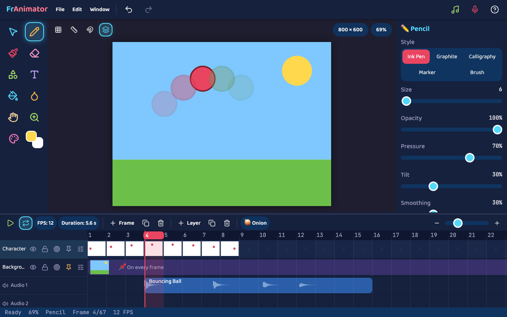

# Your FrAnimator Guide 🎨

FrAnimator lets you draw pictures and make them move!

## Make your first animation

1. Pick the **Pencil** ✏️ and draw something.
2. Press **+ Frame** to get a new, empty page.
3. Press the **onion** button 🧅 to see your last drawing, like tracing paper.
4. Draw it again, moved a tiny bit.
5. Do that a few more times.
6. Press **Play** ▶️ and watch it move!

## Your tools

| Tool | What it does |
| --- | --- |
| 👆 Select | Pick things up to move, turn or resize them. |
| ✏️ Pencil | Draw neat lines. |
| 🖌️ Paintbrush | Paint big strokes of color. |
| 🧽 Eraser | Wipe things away. |
| ⭐ Shape | Drag to make squares, circles, stars and more. |
| 🔤 Text | Click, then type your words. |
| 🪣 Paint Bucket | Fill an area with one click. |
| 💧 Eyedropper | Copy a color from your picture. |
| ✋ Hand | Slide your picture around. |
| 🔍 Zoom | Get closer to your picture. |
| 🎨 Color | Pick your colors, or a rainbow! |

Hold your mouse over anything to see what it does. On a tablet, press and hold.

## The timeline

The timeline at the bottom shows all your frames.

- Each little picture is one frame.
- **FPS** is how fast your animation plays. Try 12!
- Drag a frame to move it somewhere else.
- **Layers** are like clear sheets stacked up. Draw your character on one and the background on another.
- Press 📌 on a layer to keep it on every frame. It's perfect for backgrounds, so you only draw them once!

## Add sound 🎵

- Press the **music note** to add sound effects like Pop, Boing and Whoosh.
- Press the **microphone** to record your own voice.
- Drag a sound along the timeline to choose when it plays.

## Keep your work safe 💾

- Choose **File → Save** to keep your project.
- FrAnimator also saves a copy by itself every 30 seconds, just in case!

## Share it 🎬

Choose **File** and pick:

- **Export MP4 Video** for a movie with sound.
- **Export Animated GIF** for a picture that loops.
- **Export PNG Sequence** for every frame as a picture.

## Handy keys

| Key | What it does |
| --- | --- |
| Space | Play or pause |
| , and . | Back or forward one frame |
| Ctrl or ⌘ + Z | Undo |
| X | Swap your two colors |

Made a mistake? Just press **Undo** ↩️. Have fun! 🎉
